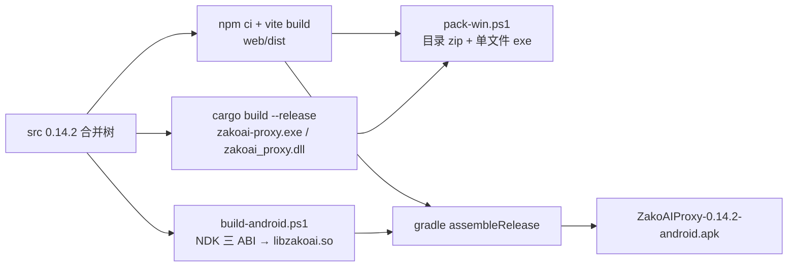

# ZakoProxyCLI 0.14.2 · Windows 与 Android 打包记录

- 基线：上游 `mizaawa/ZakoProxyCLI` **v0.14.2**（`D:\DSH work\D__代码_将ZakoProxyCLI打包为Win10\ZakoProxyCLI-main`）
- 起点：`D:\zkbuild\v0140`（上一版打包工具 + 0.14.0 改造树 + 全套离线工具链）
- 工作区：`D:\zkbuild\v0142`（`src\` 源码、`android\`、`windows\`、`scripts\`、`docs\`、`release\`、`assets\`）
- 合并仓：`D:\zkbuild\v0142\merge`（git 三方合并留痕，base/custom/upstream 三条线）

---

## 1. 这一轮做了什么

上游从 0.14.0 走到 0.14.2，本地又攒了一批改造（预设选择器、粘贴导入、认证头分派、MIME 修正、
JNI/DLL 宿主、zako-break 目录）。所以做法不是"覆盖上游文件"，而是**三方合并**：

```
a323e0d  base      = 上游 0.14.0（纯上游快照，作为共同祖先）
fb134cf  custom    = 0.14.0 + 本地 28 个文件的改造
369fd8a  upstream  = 上游 0.14.2（纯上游快照）
3becaa0  merge     = upstream ← merge custom（6 个文件人工消解冲突）
```

人工消解的 6 处冲突：

| 文件 | 冲突 | 处理 |
| --- | --- | --- |
| `src/lib.rs` | console 处理器被上游整体重写（改用 `ServeFile` + precompressed gzip）；本地改过 MIME 与 SPA 回退 | 采用上游实现（MIME 由 `mime_guess` 正确给出），保留本地"空 security_path 时放行深链"和"缺 index.html 时回 SHELL 页"两点 |
| `src/api.rs` | 本地新增 272 行 presets/parse-credential；上游同一位置改了 `profiles()` 签名（加 `Query`） | 保留本地新增块，函数签名取上游 |
| `src/profiles.rs` | 测试断言里的目录规模 | 上游 44 + zako-break 4 = 48，deepseek 家族 7 |
| `tests/multi_model.rs` | 同上（用例数、模型总数） | 48 / 62 |
| `web/src/App.tsx` | 上游重构成 `pageModules` 懒加载；本地删掉了 `PromoBanner` | 取上游结构，丢弃 `PromoBanner` 引用 |
| `web/src/Management.tsx` | 类型导入行两侧都改过 | 合并成一行（含本地新增的 `ParsedCredential`、上游的 `KeyInfo`） |

自动化合并干净通过的：`Cargo.toml`（版本抬到 0.14.2 + 保留本地 `[lib] crate-type=["rlib","cdylib"]`）、
`Cargo.lock`、`src/proxy.rs`、`src/store.rs`、`web/src/api.ts`、`web/src/Providers.tsx`。

本地改造完整保留：`src/presets.rs`、`src/embedded.rs`（JNI）、`src/launcher.rs`（`zako_launch` 导出）、
`profiles/zako-break/*`、`web/src/PresetPicker.tsx` + `preset-picker.css`、`build-android.ps1`、`Cargo.android.toml`。

---

## 2. 更新源改到自己的仓库

`src/update.rs`：

| 常量/逻辑 | 旧值 | 新值 |
| --- | --- | --- |
| `REPOSITORY` | `https://github.com/mizaawa/ZakoProxyCLI.git` | `https://github.com/ZHOUiu/ZakoProxyCLI-dosktop.git` |
| `RELEASE_API` | `api.github.com/repos/mizaawa/ZakoProxyCLI/releases/latest` | `api.github.com/repos/ZHOUiu/ZakoProxyCLI-dosktop/releases/latest` |
| `canonical_url` | `github.com/mizaawa/ZakoProxyCLI/releases/tag/{tag}` | `github.com/ZHOUiu/ZakoProxyCLI-dosktop/releases/tag/{tag}` |
| release 页白名单 | canonical + 上游 legacy | 新 canonical + 上游 `ZakoProxyCLI` / `zakoai-proxy-cli`（原仓当作容错保留，不至于换仓后旧页面全判非法） |

`web/src/App.tsx` 侧栏那个 GitHub 图标也从 `mizaawa/zakoai-proxy-cli`
改成 `ZHOUiu/ZakoProxyCLI-dosktop`，点开就是新仓库。

> 实测：匿名调 `api.github.com` 现在被限流（403 rate limit），控制台会显示"GitHub release lookup failed"，
> 这是 GitHub 侧限流，不是代码问题；仓库有正式 release 后会正常返回。

---

## 3. 构建链

工具链全部沿用 `D:\zkbuild\v0140` 里的离线副本（ASCII 路径是关键，NDK clang 和非 ASCII 路径必炸）：

```
jdkroot\jdk-21.0.2 · sdkroot (build-tools 35.0.0, platforms/android-35)
ndkroot\android-ndk-r27c · gradleroot\gradle-8.9 · gradlehome
```



关键命令：

```powershell
# 前端
cd D:\zkbuild\v0142\src\web; npm ci; npm run build
# Windows
cd D:\zkbuild\v0142\src; cargo build --release
powershell -File D:\zkbuild\v0142\scripts\pack-win.ps1
# Android 原生库
$env:ANDROID_NDK_HOME='D:\zkbuild\v0140\ndkroot\android-ndk-r27c'
$env:ANDROID_API='28'; $env:JNILIBS_OUT='D:\zkbuild\v0142\android\app\src\main\jniLibs'
powershell -File D:\zkbuild\v0142\src\build-android.ps1
# APK
$env:ZAKO_WEB_DIST='D:\zkbuild\v0142\src\web\dist'
D:\zkbuild\v0140\gradleroot\gradle-8.9\bin\gradle.bat assembleRelease
```

### 这一轮踩到的新坑：APK 里 `.gz` 与 AGP 资源合并冲突

`vite build` 现在会为静态资源产出 `.js.gz` / `.css.gz` 预压缩副本（上游 `ServeFile::precompressed_gzip`
要用）。AGP 的 asset merger 把 `x.js` 和 `x.js.gz` 折叠成同一个资源，于是 `mergeReleaseAssets` 直接失败：

```
ERROR: [web/assets/index-B8SIgUWo.js] ... Duplicate resources
```

处理：`android/app/build.gradle.kts` 的 `stageWeb` 任务里 `exclude("**/*.gz")`。
Android 宿主本来也只会拿 plain 文件，桌面版 `web\` 里的 `.gz` 保留不动。

---

## 4. 实测结果

| 项目 | 方式 | 结果 |
| --- | --- | --- |
| 前端类型检查 + 构建 | `npm run build`（含 `tsc --noEmit`） | 通过，2446 个模块，`dist` 产出完整 |
| Windows 编译 | `cargo build --release` | 通过，`zakoai-proxy.exe` 14.5 MB / `zakoai_proxy.dll` 14.2 MB |
| Windows 目录版 | 起 `ZakoAI.Desktop.exe` → 轮询 `http://127.0.0.1:1990/` | HTTP 200，`<title>ZAKO · API Relay</title>`，`id="root"` 存在；日志"已在进程内加载 zakoai_proxy.dll" |
| Windows 单文件版 | 干净目录双击 `ZakoAI-Proxy-0.14.2-Windows-x64.exe` | 展开 43 个文件 + `.payload`，进程内加载 DLL，HTTP 200 |
| Android 原生库 | `build-android.ps1` | 三 ABI 全过，均含 `Java_io_zakoai_proxy_ProxyProcess_nativeServe` |
| APK | `aapt2 dump badging` | `io.zakoai.proxy`，`versionCode 1402`，`versionName 0.14.2`，minSdk 26 / targetSdk 35 |
| APK 内容 | zip 列表 | `lib/arm64-v8a|armeabi-v7a|x86_64/libzakoai.so` + `assets/web/` 29 项 |
| APK 签名 | `apksigner verify --print-certs` | `CN=Android Debug`（本地调试签名） |
| 预设功能落地 | 检查 `dist` 分块 | `Management-*.js` 内含 `presets` + `parse-credential` 调用与 `PresetPicker` 样式 |
| 更新源 | 检查最终树 | `update.rs` 三处 + `App.tsx` 链接均指向 `ZHOUiu/ZakoProxyCLI-dosktop` |
| 单元测试 | `cargo test --lib` | **90 passed / 0 failed** |
| 集成测试 | `cargo test`（除 kimi_profiles） | 9 + 8 + 20 + 11 + 7 + 5 = **60 passed / 0 failed** |
| `kimi_profiles` | `cargo test --test kimi_profiles` | **环境问题**：测试 exe 被终端安全组件直接删除（`拒绝访问 (os error 5)`，目录里只剩 `.d`/`.pdb`），不是代码失败 |

目录规模断言也对上了合并后的真实数据：`all()` = 48 条（上游 44 + zako-break 4），
deepseek 家族 7 条，全目录模型总数 62、去重 43。

> 本轮没有可用的模拟器/实机（`sdkroot` 未装 emulator，`adb devices` 为空），APK 只做了静态校验，未上机跑。
> 上一版（0.13.3）在 Android 11 x86_64 上验证过同一套宿主逻辑，风险点仅在新版前端资源。

---

## 5. 产物

`D:\zkbuild\v0142\release\`

| 文件 | 大小 | SHA256 |
| --- | --- | --- |
| `ZakoAI-Proxy-0.14.2-Windows-x64.exe` | 6,329,044 | `F3E46B9CC80BD1A6…8F857DDF` |
| `ZakoAI-Proxy-0.14.2-Windows-x64.zip` | 11,957,741 | `F5E68D1C1EF4FB0B…2147616AD` |
| `ZakoAIProxy-0.14.2-android.apk` | 38,801,701 | `EF335AE6CD80C94E…1EAE89384` |

完整校验值见 `release/SHA256SUMS.txt`。

相比 0.13.3 那版：单文件 exe 从 5.2 MB → 6.3 MB、目录 zip 29.8 MB → 12.0 MB
（0.14 起前端拆包更细，预压缩 `.gz` 已随 web 一起打包，且目录版不再重复塞旧逻辑），
APK 29.2 MB → 38.8 MB（13–14 MB 的 `.so` × 3 + 新版前端）。

打包脚本这一轮还修了两处：`pack-win.ps1` 以前把 `build\` 整个父目录压进 zip（会混入空的
`payload\`），现在只压 `ZakoAI-Proxy-*-Windows-x64\` 一层；并在压缩前清掉冒烟测试留下的
`data\`、`logs\`、`.payload`，成品里不会再夹带运行时状态。

---

## 6. 与仓库的关系

更新检查现在指向 <https://github.com/ZHOUiu/ZakoProxyCLI-dosktop>。
要让"检查更新"真的能查到东西，这个仓库需要发布 release，且：

- `tag_name` 形如 `v0.14.2`；
- 非 draft / 非 prerelease；
- `html_url` 要么是 `github.com/ZHOUiu/ZakoProxyCLI-dosktop/releases/tag/v0.14.2`，
  要么是上游两个仓库的正式 release 页（白名单容错）。

本地 `D:\DSH work\D__代码_将ZakoProxyCLI打包为Win10\repo` 仍是 0.13.3 的内容，还没同步这一版。
